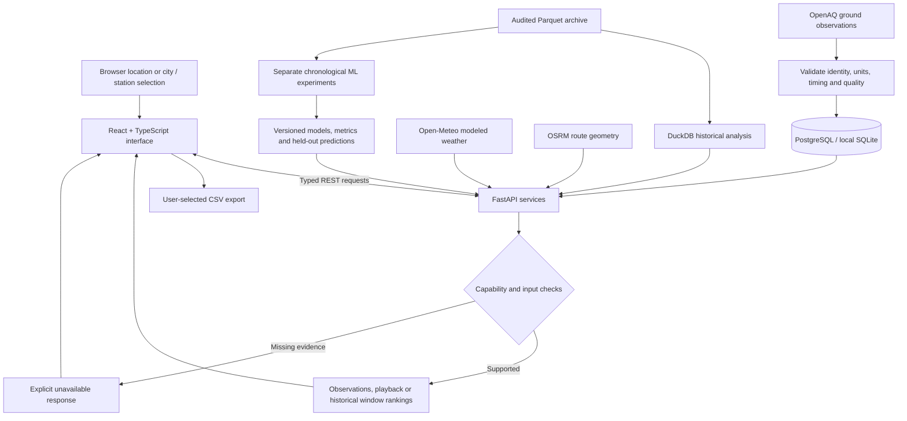

<div align="center">

# 🌬️ BreatheWise India

### Understand the air. Inspect the evidence. Plan with context.

**A Delhi-first platform for air quality monitoring, retrospective ML forecasting and historical activity planning.**

[](pyproject.toml)
[](apps/web/package.json)
[](packages/contracts/api.d.ts)
[](apps/api/src/breathewise/main.py)
[](docs/MODEL_V5_READINESS.md)
[](https://github.com/Shwetankjais/BreatheWise/actions/workflows/backend.yml)

[**Explore the website →**](https://shwetankjais.github.io/BreatheWise/) · [**API docs**](https://breathewise-api-56wc.onrender.com/docs) · [**Verification evidence**](docs/SUBMISSION.md) · [**Model research**](docs/FORECAST_ISSUE_PURGED.md)

For the hosted real-observation rollout, follow [Render live ingestion](docs/LIVE_RENDER_INGESTION.md). The OpenAQ key must stay server-side; live observations, historical replay, and operational ML forecasts have separate readiness requirements.

</div>

> **Deployment scope — verified 24 November 2026:** GitHub Pages is connected to FastAPI on Render, with working CORS. Render currently contains **synthetic demo observations**. The richer local setup uses actual Delhi observations and separately supplied archive/model assets. Operational live ML forecasts remain unavailable. [See the hosted feature report.](docs/RENDER_CONNECTION_STATUS.md)

---

## The problem

An air quality number is difficult to use without knowing **where it came from, when it was measured, what it represents and whether it is complete**. A distant station, a stale observation, a regional weather estimate and a model prediction answer different questions.

BreatheWise brings these sources into one interface while retaining their context. Starting with Delhi, it helps residents, students and environmental researchers inspect monitoring observations, study pollution patterns, evaluate forecasts and compare historical activity windows. Respiratory-sensitive users can also access general educational precautions.

**Our approach:** make useful results accessible, and make missing evidence visible.

## What you can explore

| Workspace | What it does | Current scope |
|---|---|---|
| 🗺️ **Overview & Map** | Select a station; inspect concentrations, units, source, timestamps and freshness | Real observations in the configured local setup; hosted demo station on Render |
| 📍 **Location & Weather** | Browser-permission geolocation, nearest monitor and Open-Meteo weather context | A 50 km proximity guard; weather depends on upstream availability |
| 🧪 **Pollutant Details** | Separate PM2.5, PM10, NO₂, SO₂, CO and O₃ availability | The real local intake currently imports **PM2.5 only**; missing pollutants stay unavailable |
| 📈 **Historical EDA** | Explore observed history, compare compatible station series and export results | Requires the audited archive; unavailable on the current hosted API |
| 🤖 **Model Audit** | Browse model identity, declared horizons, baseline metrics and held-out prediction playback | Local research artifacts support evaluation; hosted registry exposes metadata without those assets |
| 🕒 **Activity Replay** | Rank duration/start-time windows from one complete saved 24-hour forecast issue | Historical comparison; requires registered prediction artifacts |
| 🛣️ **Routes** | Display actual road alternatives, geometry, distance and estimated duration | Requires a configured OSRM endpoint; pollution exposure ranking is unavailable |
| 🫁 **Health Guidance** | Read pollutant-specific information and respiratory precautions | Educational, with exposure-period context; no diagnosis or personal disease-risk score |
| 🔖 **Places & Alerts** | Persist owned places, preferences and observed-concentration alert rules | Requires a provisioned bearer session; in-app alerts depend on eligible observations and worker execution |

**Research gates:** current safe-time advice, public live ML forecasting, predicted hotspots, calibrated uncertainty, population coverage extraction and weather sensitivity scenarios remain unavailable. A structured unavailable response does not mean the underlying feature is implemented.

<details>
<summary><strong>A useful first walkthrough</strong></summary>

1. Open the public website and read its deployment-scope banner.
2. Select a map marker and inspect its source, units, timestamp and missing-pollutant states.
3. Open Health Guidance and switch pollutants.
4. Open Model Audit to distinguish retrospective models from diagnostic-only artifacts.
5. In a configured local installation, explore held-out playback and historical replay planning.
6. Compare available windows by duration and sensitivity; inspect a no-suitable-window result.

The public site makes real requests to Render, but its seeded station values are synthetic. Selecting a demo preview never establishes live forecasting capability.

</details>

## How the system works



Training is performed separately from page requests. The API reads registered artifacts and checks capability/input requirements before returning supported results. Ground observations, modeled weather, historical predictions and synthetic previews retain distinct provenance.

## Machine learning: models and evidence

| Model family | Horizons | Role |
|---|---|---|
| `delhi-recorded-pm25-v1` | +1 / +3 / +6 / +12 / +24 h | Preserved retrospective LightGBM experiment; original boundary-availability limitation documented |
| `delhi-recorded-pm25-hourly-v2` | Every hour +1…+24 | Retrospective recorded-clock experiment with primary issue-purged evaluation |
| `delhi-openaq-pm25-hourly-v1` | Every hour +1…+24 | Separate UTC-native retrospective experiment |
| `delhi-openaq-pm25-delay3h-v2` | Every hour +1…+24 | Availability-aware experimental shadow model under a simulated publication-delay regime |
| `supplied-native-75-v1` | Artifact declares +1 / +3 / +6 / +12 / +24 h | Offline diagnostic recovery of the supplied 75-feature booster |
| `supplied-horizon-ensemble-v5` | Artifact declares +1 / +3 / +6 / +12 / +24 h | Five LightGBM/XGBoost pairs; 69 ordered features; diagnostic-only |

The independent experiments use lagged observations and calendar/context features defined in their source. Missing targets are excluded rather than invented. Evaluation compares matched finite cohorts against persistence and same-hour baselines. Newer primary results apply a mechanical purge at model fit/selection boundaries.

The v5 artifact stores weights **0.55 / 0.45** and `target_transform="none"`. Its original feature-builder parity, physical target units and golden output are unverified. Native numerical execution is not proof of operational environmental accuracy. [V5 audit and exact missing inputs →](docs/MODEL_V5_READINESS.md)

### The mathematics behind the implemented behavior

**Nearest-station distance.** The location service uses the Haversine formula, with angles in radians and Earth radius $R=6371$ km:

$$
a=\sin^2(\Delta\phi/2)+\cos\phi_1\cos\phi_2\sin^2(\Delta\lambda/2),\qquad
 d=2R\operatorname{atan2}(\sqrt a,\sqrt{1-a}).
$$

The 50 km guard is a station-proximity rule, not validated pollution coverage.

**Historical activity-window ranking.** For a complete hourly forecast trajectory, a candidate window $W$ of $D$ hours uses:

$$
E(W)=\sum_{h\in W}\hat c_h\Delta t,\qquad \Delta t=1\text{ hour},\qquad
\bar c(W)=E(W)/D.
$$

Here $E$ is a concentration-time proxy in µg·h/m³, not inhaled dose. General preference ranks by $E$. Sensitive preference uses the implemented engineering rule:

$$
S(W)=E(W)+0.25\,D\max_{h\in W}(\hat c_h).
$$

Candidates must fit the selected time bounds and duration. An optional user ceiling retains windows with $\bar c(W)\leq C_{\max}$; valid zero is preserved. Ties use the earlier start. Incomplete trajectories are rejected. Target observations do not determine the ranking. [Implementation and limitations →](docs/REPLAY_PLANNING.md)

**Forecast evaluation.** Reported errors are computed on the selected valid cohort:

$$
\mathrm{MAE}=\frac1N\sum_i|y_i-\hat y_i|,\qquad
\mathrm{RMSE}=\sqrt{\frac1N\sum_i(y_i-\hat y_i)^2}.
$$

**V5 diagnostic blend.** The offline adapter combines component raw outputs using the artifact's serialized weights:

$$
z_h=0.55\,f_{\mathrm{LGB},h}(x)+0.45\,f_{\mathrm{XGB},h}(x).
$$

The resulting raw diagnostic score is not published as a validated PM2.5 concentration. The exact feature order and iteration selection are recorded in the [manifest](docs/MODEL_V5_MANIFEST.json).

**Indicative pollutant sub-index.** The UI utility linearly interpolates between its concentration/index breakpoints:

$$
I=\operatorname{round}\left[I_L+\frac{I_H-I_L}{C_H-C_L}(C-C_L)\right].
$$

This utility does **not** make a single hourly observation an official overall CPCB NAQI. Averaging, completeness, unit and multi-pollutant requirements remain separate. [Code →](apps/web/src/lib/aqi.ts)

## Technology and code map

| Layer | Technologies / source |
|---|---|
| Interface | React 19, TypeScript, Vite, Tailwind, Leaflet/React Leaflet, Lucide and Motion |
| API | Python 3.12, FastAPI, Pydantic, HTTPX |
| Persistence | SQLAlchemy, Alembic, PostgreSQL; SQLite local/demo workflows |
| Analytics | Parquet and DuckDB; separate LightGBM/XGBoost diagnostic/research environments |
| Contracts | Exported OpenAPI and generated TypeScript declarations |
| Verification | pytest, Ruff, Vitest, TypeScript, Playwright, GitHub Actions |
| Hosting | GitHub Pages frontend and Render API/PostgreSQL; Docker and optional Vercel configuration |

```text
apps/api/src/breathewise/
  adapters/       OpenAQ and Open-Meteo clients
  api/            REST routers
  services/       Observation, model, replay, route and account logic
  repositories/   Database queries
  db/             Sessions and persisted entities
  ml/             Research experiments, artifact recovery and v5 adapter
apps/web/src/
  features/       Overview, planner, history, model audit, routes, health, places
  components/     Map, layout and UI controls
  lib/            Typed API client, units/index and replay helpers
packages/contracts/  OpenAPI, TypeScript definitions and explicit demo fixtures
scripts/             Ingestion, workers, training and local supervisor
tools/               Isolated model runtimes, browser tests and Pages build
docs/                Protocols, results, limitations and deployment evidence
```

Key entry points: [`create_app`](apps/api/src/breathewise/main.py), [`get_station_pollutants`](apps/api/src/breathewise/services/location.py), [`plan`](apps/api/src/breathewise/services/replay_planning.py), the [frontend API client](apps/web/src/lib/api/client.ts) and [model audit interface](apps/web/src/features/model-performance/ModelAuditView.tsx).

**No LLM is called by the running application.** Inference uses tabular ML; validation, ranking, capability decisions and educational guidance use ordinary application code. There is no runtime prompt strategy or token cost. External request counts vary with user actions, cache state and intake batches; no fixed per-user call count is claimed. Provider and hosting quotas apply, and weather rate limiting has been observed.

## Run it yourself

### 1 · Install the pinned environments

Use **Python 3.12**, **uv**, **Node.js 22** and npm. Commands below use a POSIX shell; Windows users can use WSL. Lockfiles are committed.

```bash
git clone --branch feat/foundation https://github.com/Shwetankjais/BreatheWise.git
cd BreatheWise
npm ci --no-audit --no-fund
uv sync --locked
mkdir -p work
```

Environment sources: [`pyproject.toml`](pyproject.toml) + [`uv.lock`](uv.lock), [`package.json`](package.json) + [`package-lock.json`](package-lock.json), and [`.env.example`](.env.example). Optional research runtimes each have their own `pyproject.toml` and `uv.lock` under `tools/`.

### 2 · Start an explicit demo API

```bash
export DATABASE_URL=sqlite:///work/readme-demo.db
export DATA_MODE=demo
uv run --locked alembic upgrade head
uv run --locked python scripts/data_cli.py seed-demo
uv run --locked uvicorn breathewise.main:create_app --factory --host 127.0.0.1 --port 8000
```

In a **second terminal**, from the repository root:

```bash
npm run dev --workspace apps/web
```

Open **http://127.0.0.1:5173/** and **http://127.0.0.1:8000/docs**. The demo API uses labeled seeded observations. The **Demo Preview** control additionally enables the frontend's explicit local fixtures. Missing archive/model assets remain unavailable in the server-backed demo.

<details>
<summary><strong>Docker alternative</strong></summary>

```bash
docker compose up --build
```

Configured services are PostgreSQL, FastAPI and an Nginx frontend. Open **http://localhost:3000**. Compose defaults to demo mode. This does not supply the ignored research artifacts or enable live ML inference. [Container and deployment instructions →](docs/PUBLIC_DEPLOYMENT_HANDOFF.md)

</details>

### 3 · Configure real data and research assets

A Git clone/ZIP contains source, dependency locks, manifests and demo fixtures. It does **not** contain the private observation database, source archive, joblib binaries, trained research bundles, API keys or account sessions.

| Variable | Purpose |
|---|---|
| `DATABASE_URL` | Migrated PostgreSQL or local SQLite database |
| `DATA_MODE` | `live`, `historical_replay` or `demo`; changing it does not import data |
| `OPENAQ_API_KEY` | Server-only provider credential |
| `ARCHIVE_ROOT` | Approved historical Parquet archive tree |
| `FORECAST_REGISTRY_ROOT` | Verified experiment manifests, models, predictions and supplements |
| `ROUTING_BASE_URL` | Trusted HTTPS OSRM provider |
| `WEB_ORIGIN` | Exact allowed browser origin(s), comma-separated |
| `VITE_API_BASE_URL` | Public backend origin at frontend build time; blank uses local proxy |

Follow [localhost setup](docs/LOCALHOST_PROTOTYPE.md) for archive layout, private session provisioning and the supported supervisor. Follow [Render connection status](docs/RENDER_CONNECTION_STATUS.md) for the actual hosted scope. A hosted API needs its own assets and identities. Neither setting `live` nor copying a joblib file establishes model parity.

### 4 · Reproduce research outputs and export CSV

With the approved source and optional research dependencies available:

```bash
uv sync --locked --project tools/forecast-experiment
uv run --locked --project tools/forecast-experiment python scripts/train_forecast.py \
  --source /absolute/path/to/Aanad\ Vihar.parquet \
  --model-version delhi-recorded-pm25-hourly-v2
```

This writes versioned outputs, including `heldout_predictions.csv`, under `work/forecast-experiment/delhi-recorded-pm25-hourly-v2/`. It requires the documented compatible source file and runtime; the file is not supplied by a clean ZIP. Some systems additionally require a configured OpenMP library. Primary issue-purged reporting is documented [separately](docs/FORECAST_ISSUE_PURGED.md).

With registered artifacts, open **Model Audit → choose model/horizon/held-out split → export CSV**. The download contains the **currently loaded page**, with issue/target times, observed targets, predictions, baselines, units and cohort metadata. It is an analytical export, not a competition submission file.

## Evaluation: results and failure cases

| Evidence | Recorded result | Interpretation |
|---|---|---|
| Final local integration | 13 checks each on desktop and mobile | Real API workflows, ownership and unavailable states; [evidence](docs/SUBMISSION.md) |
| Latest frontend suite | 60 tests passed; typecheck/build passed | Client behavior, replay helpers and regression checks |
| Connected public browser sweep | 10 tabs at 1440/390 px; no page errors or document overflow | Actual Render requests; server remains demo and several endpoints lack assets |
| Recorded-clock v2, issue-purged test, +1 h | MAE **18.913** vs persistence **20.870 µg/m³**; N=13,977 | Single-source retrospective result, not prospective or all-city accuracy |
| Recorded-clock v2, issue-purged test, +24 h | MAE **39.575** vs persistence **47.822 µg/m³**; N=14,291 | Same qualification; substantial high-pollution underprediction |
| Availability-aware delay experiment | Beat both matched baselines at **11/24** horizons | No claim that ML always improves on persistence |
| V5 diagnostic tests | 12 passed; golden parity test skipped | Mechanics evidence only; original inference parity remains unresolved |

Protocols and complete metrics: [issue-purged results](docs/FORECAST_ISSUE_PURGED.md), [availability experiment](docs/AVAILABILITY_FORECAST.md), [final API/browser review](docs/SUBMISSION.md).

**What we corrected during development:** removed silent demo fallback in live requests, fixed pollutant relabeling and valid-zero alert handling, added request-race guards, corrected mobile overflow/dialog issues, qualified source-clock and split-boundary limitations, removed invented map/forecast claims, and connected Pages to the hosted API with explicit scope labeling. Earlier failures remain in historical records rather than being reported as passing checks.

```bash
# Backend lint, tests, contract drift and frontend typecheck
make check

# Frontend regression suite and build
npm run test --workspace apps/web
npm run build --workspace apps/web

# Separate research mechanics
make setup-forecast-experiment
make check-forecast-experiment

# Isolated synthetic browser baseline: requires installed Chromium
make setup-browser-tests
make test-e2e
```

Actual-data browser tests and research reproduction additionally need their documented local assets. PostgreSQL-only cases require a disposable configured test database; a local skip is not a PostgreSQL pass.

## Reliability, limitations and deployment

- **Time and provenance:** retain UTC provider timing separately from unverified naive archive clocks. Recorded archive comparisons require explicit `same_recorded_clock` assumptions.
- **Missingness and units:** missing readings are not zeros. CO archive units and provider gas units require explicit handling; unsupported conversions are not inferred.
- **Late/partial inputs:** experimental runs preserve rejection reasons and zero forecast rows. Publication-time checks validate known availability; historical scenarios do not prove actual past publication times.
- **Untrusted content:** validation and escaped map labels protect application boundaries. There is no LLM thread reader or runtime prompt injection surface; externally supplied serialized models require provenance checks and isolated inspection.
- **Accounts and secrets:** owned records are session-isolated. Provider secrets stay server-side. Public signup, email delivery and a production scheduler are not included.
- **Health:** advice is educational and engineering-reviewed, not clinically validated or personalized. Particulate respirators do not remove every pollutant gas.
- **Coverage:** the imported real cohort is four Delhi stations, with PM2.5 intake. This is not nationwide sensor coverage or a validated street-level pollution surface.
- **Model risk:** high-concentration underprediction, station generalization, original-model parity and calibrated uncertainty remain unresolved.
- **Hosted scope:** Render currently lacks real archive/model bundles and routing configuration; weather can be rate-limited. Transport success is not complete feature readiness.

Real-world use could support environmental education, monitoring analysis and research evaluation. Operational public advice requires broader verified ingestion, model parity, prospective evaluation, durable storage, managed authentication, refresh scheduling and appropriate expert review. [Deployment guide →](docs/PUBLIC_DEPLOYMENT_HANDOFF.md)

## Original contributions and acknowledgements

Project contributions include the integrated interface and API, provider adapters, persistence and ownership rules, typed contracts, artifact recovery/audit tools, independently versioned research experiments, model explorer, historical replay planner and verification workflows.

We use **OpenAQ/CPCB observations**, **Open-Meteo modeled weather**, **OpenStreetMap** mapping and **OSRM** routing where configured. Health education references [WHO guidance](https://www.who.int/publications/i/item/9789240034228); the app does not claim WHO endorsement. LightGBM, XGBoost, React, FastAPI and other open-source dependencies retain their respective licenses and attribution requirements.

The supplied 75-feature and v5 joblib artifacts are **pre-existing teammate models**; this integration does not claim authorship of their original training. Reference imagery/starter material and AI coding assistants **Codex and Antigravity** supported development. There is no claim of a new forecasting algorithm, clinical validation or an independently published project research paper. Data/model redistribution approval must be established before sharing excluded assets.

## Documentation library

| Start here | Deep dive |
|---|---|
| [Problem and acceptance goals](docs/PRD.md) | [Architecture and ownership](docs/ARCHITECTURE.md) |
| [Current prototype scope](docs/PROTOTYPE_COMPLETION.md) | [API contract](docs/PROTOTYPE_CONTRACT.md) |
| [Local setup](docs/LOCALHOST_PROTOTYPE.md) | [Historical replay method](docs/REPLAY_PLANNING.md) |
| [Submission evidence](docs/SUBMISSION.md) | [V5 model audit](docs/MODEL_V5_READINESS.md) |
| [Hosted connection checks](docs/RENDER_CONNECTION_STATUS.md) | [Feature provenance](docs/FEATURE_PROVENANCE.md) |
| [UI implementation record](docs/UI_IMPLEMENTATION.md) | [Independent experiment](docs/FORECAST_EXPERIMENT.md) |

Some documents preserve earlier checkpoints. Use their latest dated sections and the hosted connection report to interpret current status.

---

<div align="center">

**BreatheWise India · Built for interpretable environmental research**
*Real observations when configured. Explicit limitations when evidence is missing.*

[Website](https://shwetankjais.github.io/BreatheWise/) · [Source](https://github.com/Shwetankjais/BreatheWise) · [API](https://breathewise-api-56wc.onrender.com/docs)

</div>
